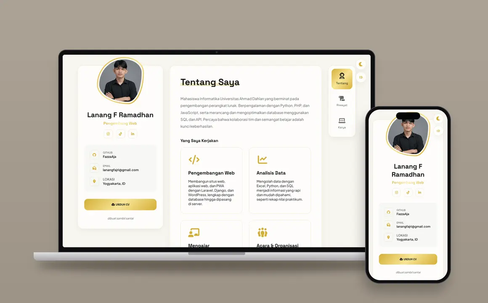

# Portofolio Lanang Fajri Ramadhan

Website portofolio pribadi Lanang Fajri Ramadhan (Fazza), Web Developer dan mahasiswa Informatika Universitas Ahmad Dahlan Yogyakarta.

🔗 **Live:** [fazzaaja.github.io](https://fazzaaja.github.io/)



## Fitur

- **Tiga halaman utama:** Tentang (profil, layanan, keahlian), Riwayat (pendidikan, pengalaman, organisasi, prestasi), dan Karya (daftar proyek).
- **Detail proyek dalam popup:** klik kartu karya untuk melihat deskripsi, teknologi, kode sumber, dan tautan website.
- **Mode gelap/terang.**
- **Dua bahasa:** Indonesia dan Inggris.
- **Animasi pembuka** (preloader) dan efek teks mengetik.
- **Responsif** di desktop maupun ponsel.
- **SEO:** meta Open Graph/Twitter, data terstruktur JSON-LD, dan sitemap.

## Teknologi

HTML, CSS, dan JavaScript murni (tanpa framework atau build step), dengan Google Fonts dan Font Awesome. Di-hosting di GitHub Pages.

## Struktur Folder

```
portfolio/
├── index.html          # Struktur halaman
├── sitemap.xml
├── css/
│   └── style.css       # Semua gaya tampilan
├── js/
│   └── main.js         # Preloader, tema, bahasa, navigasi, popup karya
└── images/
    ├── person.webp     # Foto profil
    ├── og-image.png    # Gambar pratinjau saat link dibagikan
    ├── icons/          # Favicon
    └── works/          # Screenshot proyek
```

## Menjalankan Secara Lokal

Cukup buka `index.html` di browser, atau jalankan server statis sederhana:

```bash
python -m http.server 8000
```

Lalu buka `http://localhost:8000`.

## Menambah Karya Baru

1. Simpan screenshot proyek (format `.webp`) di `images/works/`.
2. Salin salah satu blok `portfolio-card` di bagian Karya pada `index.html`, lalu ubah `data-title`, `data-desc`, `data-tools`, `data-github`, `data-link`, dan gambarnya.
3. Beri `data-i18n-card` dengan id baru (misal `w7`), lalu tambahkan teks terjemahannya (`w7_title`, `w7_sub`, `w7_desc`) untuk bahasa `id` dan `en` di `js/main.js`.

## Kontak

- Email: [lanangfajri@gmail.com](mailto:lanangfajri@gmail.com)
- GitHub: [FazzaAja](https://github.com/FazzaAja)
- LinkedIn: [fazza-aja](https://www.linkedin.com/in/fazza-aja/)
